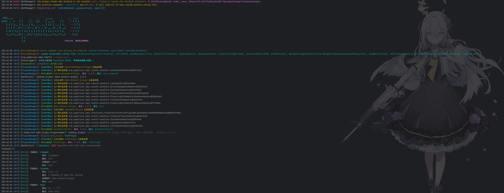

### Language: 
[简体中文](README_CN.md) / [한국어](README_KO.md) / **Español** / [Français](README_FR.md) / [Русский](README_RU.md) / [Português](README_PT.md) / [English](README.md)
# DolphinBot
DolphinBot es un framework de bots de Minecraft sin interfaz gráfica basado en GeyserMC MCProtocolLib 1.21.11-SNAPSHOT (protocolo 774).
<p align="center">
   
   <br>
    <a href="https://www.oracle.com/java/technologies/downloads/">
        
    </a>
    <a href="">
        
    </a>
    <a href="">
        
    </a>
</p>
   <div align="center">
   ✨ Un framework de bots ligero, altamente escalable y multiplataforma de versiones para servidores Minecraft generales. Incluye un gestor de plugins tipo Bukkit y APIs fáciles de usar, permitiendo personalizar el manejo de eventos. ✨
   </div>
<p align="center">
  <a href="https://github.com/NeonAngelThreads/DolphinBot/releases">
    
  </a>
  <a href="https://github.com/NeonAngelThreads/DolphinBot/releases">
        
  </a>
   <br>
   <a href="https://github.com/NeonAngelThreads/DolphinBot/commits/master/">
      
   </a>
  
  <a href="https://github.com/NeonAngelThreads/DolphinBot/issues">
    
  </a>
  <a href="https://github.com/NeonAngelThreads/DolphinBot/tree/master/src/main">
     
  </a>
  <a href="https://app.codacy.com/gh/NeonAngelThreads/DolphinBot/dashboard?utm_source=gh&utm_medium=referral&utm_content=&utm_campaign=Badge_grade">
     
  </a>
  <p align="center">
     <a href="https://github.com/NeonAngelThreads/DolphinBot/blob/master/PluginDocs.md">📖Documentación</a>
     ·
     <a href="https://github.com/NeonAngelThreads/DolphinBot/issues">🐛Enviar sugerencia/error</a>
</p> 


## ¿Por qué DolphinBot?
   - **Multi-versión**: con ViaVersion integrado, DolphinBot admite servidores desde 1.7.x hasta 1.21.11 y 26.1.
   - **Alta fiabilidad**: bajo uso de red, reconexión automática, ejecución prolongada sin preocuparse por perder conexión.
   - **Alta programabilidad**: implementa **máquinas de estado** finitas similares a **SpringBoot**, permitiendo configurar **múltiples procesos de inicio de sesión** para distintos servidores.
   - **Alta extensibilidad**: DolphinAPI madura con `listeners de paquetes`, `sistemas de eventos` y `manejadores de eventos` basados en `mc protocol lib`;
     integra una API de plugins tipo Bukkit para desarrollar plugins personalizados rápidamente.
   - **Sistema de logs avanzado**: `TextComponent` serializa colores/estilos ricos de mensajes del servidor y ofrece información de depuración útil.
   - **Alto rendimiento**: permite iniciar múltiples instancias de bots en un solo cliente con bajo CPU y memoria.
   - **Fácil de usar**: coloca perfiles de bots en el archivo de configuración en lugar de definirlos por línea de comandos.
### **Atajos**: [Guía de desarrollo de plugins personalizados](PluginDocs.md)
## Características:
   - Registro fácil de comandos personalizados que empiezan con `!` usando CommandBuilder DolphinAPI.
   - **Inyección en caliente** de plugins durante la conexión al servidor.
   - Soporte para configurar clústeres de bots e iniciarlos a la vez.

[//]: # (   - Soporte de expresiones de logs de consola con color `colorizeText&#40;"&6Hello &lWorld"&#41;`.)
   - Respuestas automáticas en `2b2t.xin` para acelerar el inicio de sesión.
   - Soporte de configuración de proxy para múltiples bots.
   - **Web Console API** - servidor HTTP API integrado para gestión/control remoto de bots.
   - **Streaming de logs en tiempo real** - logs por WebSocket con soporte de colores ANSI.
   - **Autocompletado Tab** - autocompletado en terminal web igual que en escritorio.
   - **Gestión multi-terminal** - terminal independiente por bot con pestañas.

## Capturas:
### Ejecutándose en Windows Server 2019:
<p align="center">
   
</p>

## Introducción:
   **Categorías de funciones:**
-  [`Multi-versión`](#cross-version-support)
- [`Plugins con recarga en caliente`](#hot-swapping-plugins-in-game)
- [`Interacciones en terminal`](#interactions-in-terminal)
- [`Depurador de paquetes`](#config-file-setting-)
- [`Configuración de proxy`](#config-file-setting-)
- [`Panel Web de DolphinBot`](#web-console)

**APIs de eventos implementadas:**
- [`Máquina de estados de inicio de sesión programable`](PluginDocs.md#3-programmable-login-state-machine)
- [`Sistema de comandos`](PluginDocs.md#42-commands-system)
- [`Manejadores de paquetes`](PluginDocs.md#4-deep-understand-dolphinapis)
- [`Sistema de manejadores de eventos`](PluginDocs.md#3-register-event-handlers)
   - [`Eventos de jugador`](PluginDocs.md#player-events)
- [`Chat Unicode forzado`](PluginDocs.md#unicode-string-helper)

## Soporte multi-versión
**Ahora DolphinBot puede cambiar dinámicamente entre múltiples versiones de Minecraft.**   
DolphinBot detecta automáticamente el protocolo del servidor y elige la mejor versión. Lista disponible:

| Versiones compatibles | Rango de protocolo | Estado |
|--------------------|-------------------|--------------|
| 26.1.x             | 775-777           | ✓            |
| 1.21.x             | 767-774           | ✓ Base       |
| 1.20.x             | 761-766           | ✓            |
| 1.19.x             | 759-760           | ✓            |
| 1.18.x             | 757-758           | ✓            |
| 1.17.x             | 755-756           | ✓            |
| 1.16.x             | 735-754           | ✓            |
| 1.15.x             | 573-578           | ✓            |
| 1.14.x             | 477-498           | ✓            |
| 1.13.x             | 393-404           | ✓            |
| 1.12.x             | 335-340           | ✓            |
| 1.11.x             | 315-316           | ✓            |
| 1.10.1             | 210               | ✓            |
| 1.9.x              | 107-110           | ✓            |
| 1.8.x              | 47                | ✓            |
| 1.7.x              | 4-5               | ✓            |

Puedes depurar ViaVersion en DolphinBot para inspeccionar cómo se traducen los paquetes.  
Para activar el modo debug de ViaVersion, añade la opción JVM `-Dvia.debug=true`.
```bash 
java -Dvia.debug=true -jar "DolphinBot-[version].jar"
```
## Interacciones en terminal
- Puedes enviar mensajes del juego o ejecutar comandos desde la terminal de DolphinBot.
- Comandos integrados:
-
  |         Comando de terminal         | Descripción                                       |
  |:---------------------------------:|---------------------------------------------------|
  | `reload <plugin Name> [bot name]` | Recarga en caliente un plugin especificado                  |
  |  `load <pLugin Name> [bot name]`  | Carga en caliente un plugin especificado                    |
  |        `reconnect` (`rc`)         | Reconecta al servidor en el juego.                  |
  |     `license`    (`l`, `lic`)     | Muestra la licencia en la terminal                  |
  |        `help`   (`h`, `?`)        | Muestra el menú de comandos y uso |
  |         `respawn` (`rs`)          | Hace reaparecer al bot.                                  |
   
- Para estos comandos puedes pulsar `TAB` para autocompletar.
## Primeros pasos
En esta sección aprenderás:
  - **1. Cómo iniciar directamente un solo bot por línea de comandos.**  
  - **2. Cómo especificar el perfil del bot con archivo de configuración sin línea de comandos.**  
  - **3. Cómo iniciar varios bots simultáneamente con proxy.**  
  - **4. Cómo configurar opciones avanzadas.**  
  - **5. Cómo crear un plugin personalizado.**  
  - **6. Cómo usar Web Console para gestión remota.**  

1. **Descargar el cliente**  
   Descarga el archivo jar: `DolphinBot-[version]-full.jar`.  

> [!IMPORTANT]
> Requisitos: **Java >= 17**

2. **Configuración del bot**  
### Configurar perfil 
   Hay dos formas de configurar el bot:
   - Para iniciar rápido y simple, usa **configuración por línea de comandos**  
   - Para iniciar varios bots y acceder a opciones avanzadas, usa **archivo de configuración**    

1. **Configuración por línea de comandos**  
     El perfil del juego debe definirse en la línea de comandos de arranque.  
     Ejemplo de argumentos:
     ```bash
     java -jar "DolphinBot-[version]-full.jar" --username=[username] --password=[password] --skin-recorder=[enable/disable]
     ```
   | Argumento  | Descripción                                                                |
   |--------------------|----------------------------------------------------------------------------|
   | `--username`       | Nombre visible del bot en el juego.                                            |
   | `--password`       | Contraseña para iniciar sesión o registrarse.                                            |
   | `--auto-reconnect` | Si reconectar al servidor tras expulsión o desconexión. |
   | `--skin-recorder`  | Si capturar y guardar automáticamente skins de jugadores en línea.                  |
   | `--server`         | Dirección del servidor objetivo.                                                     |
   | `--port`           | Puerto del servidor objetivo.                                                        |

   Ejemplo:
     ```bash
     java -jar "DolphinBot-[version]-full.jar" --username=[username] --password=[password] --server=0.0.0.0 --port=25565
     ```
     ```bash
     java -jar "DolphinBot-[version]-full.jar" --username=Dolphin1 --password=123 --server=2b2t.xin --port=25565 --owner=Melibertan
     ```
   <p align="center">
     
   </p>
         
> [!NOTE]
> La línea de comandos tiene mayor prioridad que el archivo de configuración; si hay opciones duplicadas, solo se reconoce la línea de comandos y se ignora el archivo.  
   
> [!TIP]
> Opcionalmente, añade más opciones:  
   `--owner` : especifica quién puede usar este bot.  
   
  **Ejemplo:**   
   `--owner=Melibertan`, también puedes definir varios nombres separados por `;`.  
   **Ejemplo:**  
   `--owner=owner1;owner2;owner3;...`  

   ### Configuración por archivo    
   Los archivos incluyen configuración global `bot.config.global.json` y perfiles `bot.profiles.json`.  
      También puedes mover los argumentos de perfil al archivo `bot.profiles.json` con el siguiente formato; se cargarán todos los valores.
      DolphinBot aplica primero las opciones de línea de comandos; las duplicadas en el archivo se ignoran.    
      La ruta del archivo es opcional; usa `--config-file` para ubicar el directorio o archivo.  
      Ejemplo:  
   ```bash 
   java -jar "DolphinBot-[version].jar" --config-file=path/to/config.json
   ```
   Si la ruta es un directorio, Dolphin extraerá el archivo de configuración por defecto allí.  
   ```bash
   java -jar "DolphinBot-[version].jar" --config-file=path/to/config_directory
   ```
   Si falta `--config-file`, DolphinBot creará un archivo por defecto en el directorio del jar.  
   ```bash 
   java -jar "DolphinBot-[version].jar"
   ```
   **Múltiples bots y proxy**  
      En el archivo de perfiles, crea el campo `profiles` en `bot.profiles.json` para especificar varios perfiles de bot.  
               
> [!NOTE]
> Algunos servidores prohíben varios bots desde la misma IP; la configuración de proxy ayuda a ejecutar bots desde distintas redes o IP de salida.  
     
Para configurar proxy por bot, edita el campo `proxy`. Ejemplo:
        
> [!WARNING]
> Definir varios bots puede activar anti-bot o anti-cheat; servidores estrictos pueden prohibirlo.
    
```json
{
   "profiles": {
      "bot#1": {
         "name": "Player494",
         "password": "123example",
         "owner": ["player_name"],
         "enabled_plugins": [
            "QuestionAnswerer",
            "MessageDisplay",
            "HumanVerify"
         ],
         "proxy": {
            "enabled": false,
            "info": {
               "address": "XX.XXX.XXX.XX",
               "port": 8081,
               "type": "SOCKS4",
               "username": "",
               "password": ""
            }
         }
      },
      "bot#2": {
         "name": "Player495",  
         "password": "password",
         "owner": ["player_name", "other_owner"],
         "enabled_plugins": [
            "HumanVerify"
         ],
         "proxy": {
            "enabled": false,
            "info": {"...": "..."}
         }
      },
      "bot#3": {"...": "..."}
   }
}
```
          
   1. `enabled_plugins` indica qué plugins habilitar en el bot.   
   2. `proxy` (opcional) define el proxy de cada bot; `enabled` activa esta configuración,   
              `info` contiene:
      
      | Campo       | Descripción                                     |
      |-------------|-------------------------------------------------|
      | `address`   | IP remota o nombre de host del proxy. |
      | `port`      | Puerto del proxy.                              |
      | `type`      | Modo de proxy. (`HTTP`, `SOCKS4`, `SOCKS5`)        |

> [!TIP]
> "username" y "password" son opcionales; añádelos si el proxy requiere autenticación.

   Para cargar `bot#1` como bot único, añade:  
   ```bash
   java -jar "DolphinBot-[version].jar" --config-file=path/to/config_directory --profiles="bot#1"
   ```
   ```bash
   java -jar "DolphinBot-[version].jar" --profiles="bot#1"
   ```   
   Para iniciar varios bots, especifica varios nombres en `--profiles`, separados por `;`.

   **Ejemplos:**
   ```bash
   java -jar "DolphinBot-[version].jar" --profiles="bot#1;bot#2;bot#3;..."
   ```

> [!NOTE]
> Si falta `--profiles`, se cargan todos los bots del archivo de perfiles por defecto.  

**Propietarios:**  
   Para limitar el uso a jugadores concretos, pon sus nombres en `owner` como lista.  
   **Ejemplo:**
```json
{
   "profiles": {
      "bot#1": {
         "name": "Player494",
         "password": "123example",
         "owner": [
            "owner1", 
            "owner2",
            "owner3"
         ],
         "enabled_plugins": [ "QuestionAnswerer", "MessageDisplay", "HumanVerify" ],
         "proxy": {
            "enabled": false,
            "info": {
               "address": "XX.XXX.XXX.XX",
               "port": 8081, 
               "type": "SOCKS4",
               "username": "",
               "password": ""
            }
         }
      }
   }
}
```
### Configuración avanzada (opcional)
   Para más opciones avanzadas, edita `bot.config.global.json`.  
   Cada opción equivale a la de línea de comandos y todos los valores, incluidos no reconocidos, se analizan; puedes añadir opciones personalizadas.  
   Ejemplo:
```json
{
  "server": "2b2t.xin",
  "port": 25565,
  "auto-reconnect": true,
  "packet-filter-delay": 0,
  "msg-send-delay": 0,
  "max-chunk-view": 12,
  "language": "zh",
  "connect-timing-out": 2000,
  "reconnect-delay": 5000,
  "debug-settings": {
    "enable-packet-debug": false,
    "packet-warning": true
  },
  "other": {
    "enable-skin-recorder": false
  }
}
```   
   ### Opciones de configuración:
   
   | Configuración                 | Descripción                                                                |
   |------------------------|----------------------------------------------------------------------------|
   | `server`               | Define la dirección del servidor.                                               |
   | `port`                 | Define el puerto del servidor.                                                  |
   | `auto-reconnecting`    | Si reconectar tras expulsión o desconexión. |
   | `enable-skin-recorder` | Si habilitar el registrador de skins.                                              |
   | `packet-filter-delay`  | Retardo máximo de recepción entre paquetes objetivo (ms).                   |
   | `max-chunk-view`       | Escala máxima de recepción de paquetes de chunk.                                       |
   | `connect-timing-out`   | Milisegundos para determinar tiempo de conexión agotado.           |
   | `reconnect-delay`      | Retardo mínimo de enfriamiento al reconectar (ms).                |
   | `msg-send-delay`       | Retardo para enviar mensajes del juego.                                     |
   | `enable-packet-debug`  | Si habilitar el depurador de paquetes.                                            |
   | `packet-warning`       | Si mostrar errores de paquetes.                                              |
   | `language`             | Configuración de idioma de UI. (Actualmente `zh`, `en`)          |


## Web Console
DolphinBot incluye una Web Console integrada para gestión y control remoto. Puedes administrar bots mediante una interfaz web moderna sin acceso directo a terminal.

### Iniciar Web Console
Para habilitarla, añade `--api` al iniciar DolphinBot:

```bash
java -jar "DolphinBot-[version]-full.jar" --api [port]
```

El servidor API se inicia en el puerto indicado (por defecto: 25560) y el servidor WebSocket de logs en puerto+1 (por defecto: 25561).

### Funciones de Web Console
- **Panel de gestión de bots** - estado en tiempo real, modo de juego y posición de todos los bots
- **Terminales independientes** - una terminal por bot con pestañas
- **Streaming de logs en tiempo real** - logs al terminal web con colores ANSI
- **Autocompletado Tab** - igual que la terminal de escritorio
- **UI/UX moderna** - diálogos modales, notificaciones toast y diseño responsive
- **Estadísticas de bots** - progreso circular de tasa online con estados por color

### Acceso a Web Console
Con el API en ejecución, accede a:
```
http://localhost:8080
```

La Web Console es una aplicación Spring Boot separada en `web-console/`. Consulta [Documentación de Web Console](web-console/README.md).

### Endpoints API
La API HTTP integrada ofrece:

| Endpoint | Método | Descripción              |
|-----------|----------|--------------------------|
| `/api/health` | GET | Comprobación de salud             |
| `/api/bots` | GET | Listar todos los bots            |
| `/api/bots/start` | POST | Iniciar un bot              |
| `/api/bots/stop` | POST | Detener un bot              |
| `/api/bots/send-command` | POST | Enviar comando a un bot    |
| `/api/config` | GET/POST | Obtener/actualizar configuración |
| `/api/bot/create`      |   POST       | crear nuevo bot           |             
| `/api/bot/delete`      |     POST         | eliminar bot especificado     |      

### Endpoints WebSocket
| Endpoint | Descripción |
|-----------|-------------|
| `ws://localhost:25561` | Streaming de logs y autocompletado Tab |

## FAQ

- ¿Puedo crear mi plugin para DolphinBot?   
    Sí, DolphinBot tiene un sistema de plugins fácil de usar con API tipo Bukkit; aquí está la [guía completa de desarrollo.](PluginDocs.md)


- ¿Es difícil configurar los archivos?  
    No, la configuración inicial es suficiente para la mayoría de casos.


- ¿Cómo reporto problemas o pido funciones?  
    Abre un issue en GitHub Issues. Se agradecen pasos detallados o reproducciones.


- ¿Puedo unirme al desarrollo de DolphinBot?  
    ¡Claro! Puedes ser el **segundo contribuidor** del equipo DolphinBot. Únete cuando quieras.

### Nuestro primer contribuidor:
1. huangdihd - (Corrigió un bug crítico en el commit `#372990a`)
## Comunidad
  - ¿Encontraste un bug? ¡Issues y sugerencias son bienvenidos!  
  Mi espacio de Bilibili:
  https://m.bilibili.com/space/386644641  
  - Si te gusta DolphinBot, ¡una **star** ayuda mucho!

## Licencia
GPL-3.0 o posterior, consulta el [LICENSE completo](LICENSE).

### **By NeonAngelThreads, coding with ❤️**