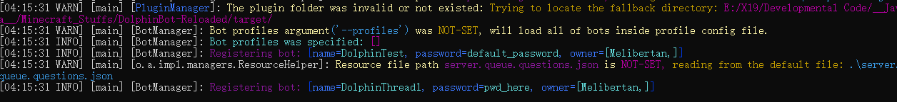

### Language: 
[简体中文](README_CN.md) / [한국어](README_KO.md) / [Español](README_ES.md) / [Français](README_FR.md) / [Русский](README_RU.md) / **Português** / [English](README.md)
# DolphinBot
DolphinBot é um framework de bots Minecraft headless baseado em GeyserMC MCProtocolLib 1.21.11-SNAPSHOT (protocolo 774).
<p align="center">
   
   <br>
    <a href="https://www.oracle.com/java/technologies/downloads/">
        
    </a>
    <a href="">
        
    </a>
    <a href="">
        
    </a>
</p>
   <div align="center">
   ✨ Um framework de bots leve, altamente escalável e multi-versão para servidores Minecraft gerais. Inclui gerenciador de plugins estilo Bukkit e APIs fáceis de usar, permitindo personalizar o tratamento de eventos. ✨
   </div>
<p align="center">
  <a href="https://github.com/NeonAngelThreads/DolphinBot/releases">
    
  </a>
  <a href="https://github.com/NeonAngelThreads/DolphinBot/releases">
        
  </a>
   <br>
   <a href="https://github.com/NeonAngelThreads/DolphinBot/commits/master/">
      
   </a>
  
  <a href="https://github.com/NeonAngelThreads/DolphinBot/issues">
    
  </a>
  <a href="https://github.com/NeonAngelThreads/DolphinBot/tree/master/src/main">
     
  </a>
  <a href="https://app.codacy.com/gh/NeonAngelThreads/DolphinBot/dashboard?utm_source=gh&utm_medium=referral&utm_content=&utm_campaign=Badge_grade">
     
  </a>
  <p align="center">
     <a href="https://github.com/NeonAngelThreads/DolphinBot/blob/master/PluginDocs.md">📖Docs</a>
     ·
     <a href="https://github.com/NeonAngelThreads/DolphinBot/issues">🐛Enviar sugestão/bug</a>
</p> 


## Por que DolphinBot?
   - **Multi-versão**: com ViaVersion integrado, suporta servidores de 1.7.x a 1.21.11 e 26.1.
   - **Alta confiabilidade**: baixo uso de rede, reconexão automática, execução longa sem perder conexão.
   - **Alta programabilidade**: **máquinas de estado** finitas similares ao **SpringBoot**, permitindo configurar **vários processos de login** por servidor.
   - **Alta extensibilidade**: DolphinAPI madura com `listeners de pacotes`, `sistemas de eventos` e `handlers de eventos` baseados em `mc protocol lib`;
     API de plugins estilo Bukkit para desenvolver plugins personalizados rapidamente.
   - **Sistema de logs avançado**: serializador `TextComponent` para cores/estilos ricos das mensagens do servidor e informações de depuração.
   - **Alto desempenho**: vários bots em um único cliente com baixo CPU/memória.
   - **Fácil de usar**: perfis de bots no arquivo de configuração, sem linha de comando.
### **Atalhos**: [Guia de desenvolvimento de plugins personalizados](PluginDocs.md)
## Recursos:
   - Registro fácil de comandos personalizados iniciados com `!` usando CommandBuilder DolphinAPI.
   - **Injeção a quente** de plugins durante a conexão ao servidor.
   - Configuração de clusters de bots e início simultâneo.

[//]: # (   - Suporte a expressões de logs coloridos no console `colorizeText&#40;"&6Hello &lWorld"&#41;`.)
   - Respostas automáticas no `2b2t.xin` para acelerar o login.
   - Suporte a configuração de proxy para vários bots.
   - **Web Console API** - servidor HTTP API integrado para gerenciamento/controle remoto.
   - **Streaming de logs em tempo real** - logs via WebSocket com suporte a cores ANSI.
   - **Tab Completion** - autocompletar no terminal web igual ao desktop.
   - **Gerenciamento multi-terminal** - terminal independente por bot com abas.

## Capturas:
### Executando no Windows Server 2019:
<p align="center">
   
</p>

## Introdução:
   **Categorias de recursos:**
-  [`Multi-versão`](#cross-version-support)
- [`Plugins com hot-reload`](#hot-swapping-plugins-in-game)
- [`Interações no terminal`](#interactions-in-terminal)
- [`Depurador de pacotes`](#config-file-setting-)
- [`Configurações de proxy`](#config-file-setting-)
- [`Dashboard Web do DolphinBot`](#web-console)

**APIs de eventos implementadas:**
- [`Máquina de estados de login programável`](PluginDocs.md#3-programmable-login-state-machine)
- [`Sistema de comandos`](PluginDocs.md#42-commands-system)
- [`Handlers de pacotes`](PluginDocs.md#4-deep-understand-dolphinapis)
- [`Sistema de handlers de eventos`](PluginDocs.md#3-register-event-handlers)
   - [`Eventos de jogador`](PluginDocs.md#player-events)
- [`Chat Unicode forçado`](PluginDocs.md#unicode-string-helper)

## Suporte multi-versão
**Agora o DolphinBot pode alternar dinamicamente entre várias versões do Minecraft.**   
O DolphinBot detecta automaticamente o protocolo do servidor e escolhe a melhor versão. Lista:

| Versões suportadas | Faixa de protocolo | Status |
|--------------------|-------------------|--------------|
| 26.1.x             | 775-777           | ✓            |
| 1.21.x             | 767-774           | ✓ Base       |
| 1.20.x             | 761-766           | ✓            |
| 1.19.x             | 759-760           | ✓            |
| 1.18.x             | 757-758           | ✓            |
| 1.17.x             | 755-756           | ✓            |
| 1.16.x             | 735-754           | ✓            |
| 1.15.x             | 573-578           | ✓            |
| 1.14.x             | 477-498           | ✓            |
| 1.13.x             | 393-404           | ✓            |
| 1.12.x             | 335-340           | ✓            |
| 1.11.x             | 315-316           | ✓            |
| 1.10.1             | 210               | ✓            |
| 1.9.x              | 107-110           | ✓            |
| 1.8.x              | 47                | ✓            |
| 1.7.x              | 4-5               | ✓            |

Você pode depurar o ViaVersion no DolphinBot para inspecionar a tradução de pacotes.  
Para ativar o modo debug do ViaVersion, adicione a opção JVM `-Dvia.debug=true`.
```bash 
java -Dvia.debug=true -jar "DolphinBot-[version].jar"
```
## Interações no terminal
- Envie mensagens no jogo ou execute comandos pelo terminal do DolphinBot.
- Comandos integrados:
-
  |         Comando de terminal         | Descrição                                       |
  |:---------------------------------:|---------------------------------------------------|
  | `reload <plugin Name> [bot name]` | Hot-reload de um plugin especificado                  |
  |  `load <pLugin Name> [bot name]`  | Hot-load de um plugin especificado                    |
  |        `reconnect` (`rc`)         | Reconecta ao servidor no jogo.                  |
  |     `license`    (`l`, `lic`)     | Mostra a licença no terminal                  |
  |        `help`   (`h`, `?`)        | Mostra o menu e uso dos comandos |
  |         `respawn` (`rs`)          | Faz o bot renascer.                                  |
   
- Use `TAB` para autocompletar.
## Primeiros passos
Nesta seção:
  - **1. Como iniciar diretamente um único bot pela linha de comando.**  
  - **2. Como especificar o perfil do bot em arquivo de configuração sem linha de comando.**  
  - **3. Como iniciar vários bots simultaneamente com proxy.**  
  - **4. Como configurar opções avançadas.**  
  - **5. Como criar um plugin personalizado.**  
  - **6. Como usar o Web Console para gerenciamento remoto.**  

1. **Baixar o cliente**  
   Baixe o jar: `DolphinBot-[version]-full.jar`.  

> [!IMPORTANT]
> Requisitos: **Java >= 17**

2. **Configuração do bot**  
### Configurando perfil 
   Duas formas:
   - Início rápido simples: **linha de comando**  
   - Vários bots e opções avançadas: **arquivo de configuração**    

1. **Configuração por linha de comando**  
     O perfil deve ser definido na linha de comando de inicialização.  
     Exemplo:
     ```bash
     java -jar "DolphinBot-[version]-full.jar" --username=[username] --password=[password] --skin-recorder=[enable/disable]
     ```
   | Argumento  | Descrição                                                                |
   |--------------------|----------------------------------------------------------------------------|
   | `--username`       | Nome exibido do bot no jogo.                                            |
   | `--password`       | Senha para login ou registro.                                            |
   | `--auto-reconnect` | Reconectar após kick/desconexão. |
   | `--skin-recorder`  | Capturar e salvar skins de jogadores online automaticamente.                  |
   | `--server`         | Endereço do servidor alvo.                                                     |
   | `--port`           | Porta do servidor alvo.                                                        |

   Exemplo:
     ```bash
     java -jar "DolphinBot-[version]-full.jar" --username=[username] --password=[password] --server=0.0.0.0 --port=25565
     ```
     ```bash
     java -jar "DolphinBot-[version]-full.jar" --username=Dolphin1 --password=123 --server=2b2t.xin --port=25565 --owner=Melibertan
     ```
   <p align="center">
     
   </p>
         
> [!NOTE]
> A linha de comando tem prioridade sobre o arquivo; duplicados no arquivo são ignorados.  
   
> [!TIP]
> Opcionalmente:  
   `--owner` : especifica quem pode usar o bot.  
   
  **Exemplo:**   
   `--owner=Melibertan`, vários nomes separados por `;`.  
   **Exemplo:**  
   `--owner=owner1;owner2;owner3;...`  

   ### Configuração por arquivo    
   Arquivos: configuração global `bot.config.global.json` e perfis `bot.profiles.json`.  
      Mova os argumentos de perfil para `bot.profiles.json` conforme formato abaixo; todos os valores serão carregados.
      DolphinBot aplica primeiro a linha de comando; duplicados do arquivo são ignorados.    
      O caminho é opcional via `--config-file` para diretório ou arquivo.  
      Exemplo:  
   ```bash 
   java -jar "DolphinBot-[version].jar" --config-file=path/to/config.json
   ```
   Se o caminho for diretório, Dolphin extrai a configuração padrão nele.  
   ```bash
   java -jar "DolphinBot-[version].jar" --config-file=path/to/config_directory
   ```
   Sem `--config-file`, DolphinBot cria um arquivo padrão no diretório do jar.  
   ```bash 
   java -jar "DolphinBot-[version].jar"
   ```
   **Vários bots e proxy**  
      No arquivo de perfis, crie o campo `profiles` em `bot.profiles.json` para vários bots.  
               
> [!NOTE]
> Alguns servidores proíbem vários bots do mesmo IP; proxy ajuda a usar redes/IPs de saída diferentes.  
     
Para configurar proxy por bot, edite `proxy`:
        
> [!WARNING]
> Vários bots podem acionar anti-bot/anti-cheat; servidores rígidos podem proibir.
    
```json
{
   "profiles": {
      "bot#1": {
         "name": "Player494",
         "password": "123example",
         "owner": ["player_name"],
         "enabled_plugins": [
            "QuestionAnswerer",
            "MessageDisplay",
            "HumanVerify"
         ],
         "proxy": {
            "enabled": false,
            "info": {
               "address": "XX.XXX.XXX.XX",
               "port": 8081,
               "type": "SOCKS4",
               "username": "",
               "password": ""
            }
         }
      },
      "bot#2": {
         "name": "Player495",  
         "password": "password",
         "owner": ["player_name", "other_owner"],
         "enabled_plugins": [
            "HumanVerify"
         ],
         "proxy": {
            "enabled": false,
            "info": {"...": "..."}
         }
      },
      "bot#3": {"...": "..."}
   }
}
```
          
   1. `enabled_plugins` indica quais plugins habilitar no bot.   
   2. `proxy` (opcional) define o proxy do bot; `enabled` ativa a configuração,   
              `info` contém:
      
      | Campo       | Descrição                                     |
      |-------------|-------------------------------------------------|
      | `address`   | IP remoto ou host do proxy. |
      | `port`      | Porta do proxy.                              |
      | `type`      | Modo proxy. (`HTTP`, `SOCKS4`, `SOCKS5`)        |

> [!TIP]
> "username" e "password" são opcionais; adicione se o proxy exigir autenticação.

   Para carregar `bot#1` como bot único:  
   ```bash
   java -jar "DolphinBot-[version].jar" --config-file=path/to/config_directory --profiles="bot#1"
   ```
   ```bash
   java -jar "DolphinBot-[version].jar" --profiles="bot#1"
   ```   
   Para vários bots, separe nomes em `--profiles` por `;`.

   **Exemplos:**
   ```bash
   java -jar "DolphinBot-[version].jar" --profiles="bot#1;bot#2;bot#3;..."
   ```

> [!NOTE]
> Sem `--profiles`, todos os bots do arquivo de perfis são carregados.  

**Proprietários:**  
   Limite o uso a jogadores específicos via `owner`.  
   **Exemplo:**
```json
{
   "profiles": {
      "bot#1": {
         "name": "Player494",
         "password": "123example",
         "owner": [
            "owner1", 
            "owner2",
            "owner3"
         ],
         "enabled_plugins": [ "QuestionAnswerer", "MessageDisplay", "HumanVerify" ],
         "proxy": {
            "enabled": false,
            "info": {
               "address": "XX.XXX.XXX.XX",
               "port": 8081, 
               "type": "SOCKS4",
               "username": "",
               "password": ""
            }
         }
      }
   }
}
```
### Configuração avançada (opcional)
   Para mais opções, edite `bot.config.global.json`.  
   Cada opção equivale à linha de comando; todos os valores, inclusive desconhecidos, são analisados.  
   Exemplo:
```json
{
  "server": "2b2t.xin",
  "port": 25565,
  "auto-reconnect": true,
  "packet-filter-delay": 0,
  "msg-send-delay": 0,
  "max-chunk-view": 12,
  "language": "zh",
  "connect-timing-out": 2000,
  "reconnect-delay": 5000,
  "debug-settings": {
    "enable-packet-debug": false,
    "packet-warning": true
  },
  "other": {
    "enable-skin-recorder": false
  }
}
```   
   ### Opções de configuração:
   
   | Configuração                 | Descrição                                                                |
   |------------------------|----------------------------------------------------------------------------|
   | `server`               | Endereço do servidor.                                               |
   | `port`                 | Porta do servidor.                                                  |
   | `auto-reconnecting`    | Reconectar após kick/desconexão. |
   | `enable-skin-recorder` | Ativa o gravador de skins.                                              |
   | `packet-filter-delay`  | Atraso máximo de recebimento entre pacotes alvo (ms).                   |
   | `max-chunk-view`       | Escala máxima de recebimento de pacotes chunk.                                       |
   | `connect-timing-out`   | Milissegundos para timeout de conexão.           |
   | `reconnect-delay`      | Atraso mínimo de resfriamento ao reconectar (ms).                |
   | `msg-send-delay`       | Atraso de envio de mensagens no jogo.                                     |
   | `enable-packet-debug`  | Ativa o depurador de pacotes.                                            |
   | `packet-warning`       | Mostra erros de pacotes.                                              |
   | `language`             | Configuração de idioma da UI. (Atualmente `zh`, `en`)          |


## Web Console
O DolphinBot inclui um Web Console integrado para gerenciamento/controle remoto. Gerencie bots por uma interface web moderna sem acesso direto ao terminal.

### Iniciar Web Console
Adicione `--api` ao iniciar:

```bash
java -jar "DolphinBot-[version]-full.jar" --api [port]
```

O servidor API inicia na porta especificada (padrão: 25560) e o WebSocket de logs em port+1 (padrão: 25561).

### Recursos
- **Dashboard de gerenciamento** - status em tempo real, modo de jogo e posição
- **Terminais independentes** - um terminal por bot com abas
- **Streaming de logs em tempo real** - logs ANSI no terminal web
- **Tab Completion** - igual ao terminal desktop
- **UI/UX moderna** - diálogos modais, notificações toast e design responsivo
- **Estatísticas de bots** - progresso circular da taxa online com status coloridos

### Acesso
Com a API em execução:
```
http://localhost:8080
```

O Web Console é uma aplicação Spring Boot separada em `web-console/`. Veja [Documentação do Web Console](web-console/README.md).

### Endpoints API
| Endpoint | Método | Descrição              |
|-----------|----------|--------------------------|
| `/api/health` | GET | Verificação de saúde             |
| `/api/bots` | GET | Listar todos os bots            |
| `/api/bots/start` | POST | Iniciar um bot              |
| `/api/bots/stop` | POST | Parar um bot              |
| `/api/bots/send-command` | POST | Enviar comando ao bot    |
| `/api/config` | GET/POST | Obter/atualizar configuração |
| `/api/bot/create`      |   POST       | criar novo bot           |             
| `/api/bot/delete`      |     POST         | excluir bot especificado     |      

### Endpoints WebSocket
| Endpoint | Descrição |
|-----------|-------------|
| `ws://localhost:25561` | Streaming de logs e Tab Completion |

## FAQ

- Posso criar meu plugin para DolphinBot?   
    Sim, o DolphinBot tem sistema de plugins fácil com API estilo Bukkit; [guia completo.](PluginDocs.md)


- É difícil configurar os arquivos?  
    Não, a configuração inicial é suficiente na maioria dos casos.


- Como reporto problemas ou peço recursos?  
    Abra uma issue no GitHub Issues. Passos detalhados ou reproduções são bem-vindos.


- Posso participar do desenvolvimento?  
    Claro! Você pode se tornar o **segundo contribuidor** da equipe DolphinBot.

### Nosso primeiro contribuidor:
1. huangdihd - (Corrigiu um bug crítico no commit `#372990a`)
## Comunidade
  - Encontrou um bug? Issues e sugestões são bem-vindas!  
  Meu espaço no Bilibili:
  https://m.bilibili.com/space/386644641  
  - Se gosta do DolphinBot, uma **star** ajuda muito!

## Licença
GPL-3.0 ou posterior, veja o [LICENSE completo](LICENSE).

### **By NeonAngelThreads, coding with ❤️**