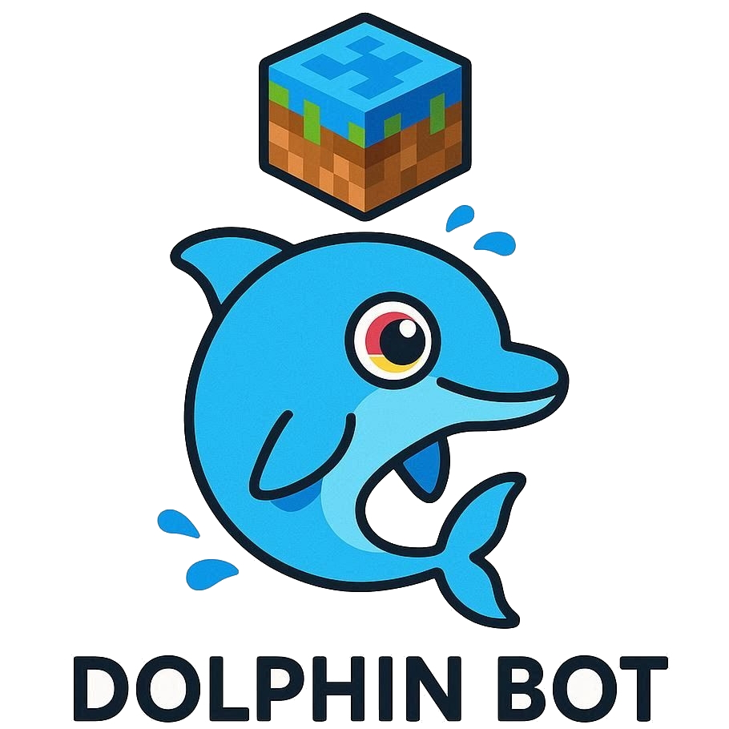

### Language: 
[简体中文](README_CN.md) / [한국어](README_KO.md) / [Español](README_ES.md) / [Français](README_FR.md) / **Русский** / [Português](README_PT.md) / [English](README.md)
# DolphinBot
DolphinBot — это безголовый фреймворк Minecraft-ботов на базе GeyserMC MCProtocolLib 1.21.11-SNAPSHOT (протокол 774).
<p align="center">
   
   <br>
    <a href="https://www.oracle.com/java/technologies/downloads/">
        
    </a>
    <a href="">
        
    </a>
    <a href="">
        
    </a>
</p>
   <div align="center">
   ✨ Лёгкий, высокомасштабируемый и кроссплатформенный по версиям фреймворк ботов для обычных Minecraft-серверов. Включает менеджер плагинов в стиле Bukkit и простые API, позволяя настраивать обработку событий. ✨
   </div>
<p align="center">
  <a href="https://github.com/NeonAngelThreads/DolphinBot/releases">
    
  </a>
  <a href="https://github.com/NeonAngelThreads/DolphinBot/releases">
        
  </a>
   <br>
   <a href="https://github.com/NeonAngelThreads/DolphinBot/commits/master/">
      
   </a>
  
  <a href="https://github.com/NeonAngelThreads/DolphinBot/issues">
    
  </a>
  <a href="https://github.com/NeonAngelThreads/DolphinBot/tree/master/src/main">
     
  </a>
  <a href="https://app.codacy.com/gh/NeonAngelThreads/DolphinBot/dashboard?utm_source=gh&utm_medium=referral&utm_content=&utm_campaign=Badge_grade">
     
  </a>
  <p align="center">
     <a href="https://github.com/NeonAngelThreads/DolphinBot/blob/master/PluginDocs.md">📖Документация</a>
     ·
     <a href="https://github.com/NeonAngelThreads/DolphinBot/issues">🐛Предложить/сообщить об ошибке</a>
</p> 


## Почему DolphinBot?
   - **Кроссплатформенность версий**: с ViaVersion поддерживаются серверы от 1.7.x до 1.21.11 и 26.1.
   - **Высокая надёжность**: низкий сетевой трафик, автопереподключение, долгая работа без потери соединения.
   - **Высокая программируемость**: конечные **машины состояний** в стиле **SpringBoot**, позволяющие настраивать **несколько процессов входа** для разных серверов.
   - **Высокая расширяемость**: зрелый DolphinAPI с `слушателями пакетов`, `системами событий` и `обработчиками событий` на `mc protocol lib`;
     API плагинов в стиле Bukkit для быстрой разработки пользовательских плагинов.
   - **Продвинутое логирование**: сериализатор `TextComponent` для цветов/стилей сообщений сервера и полезной отладочной информации.
   - **Высокая производительность**: несколько экземпляров ботов в одном клиенте при низком CPU/памяти.
   - **Простота использования**: профили ботов в конфигурационном файле вместо командной строки.
### **Быстрые ссылки**: [Руководство по разработке плагинов](PluginDocs.md)
## Возможности:
   - Простая регистрация пользовательских команд, начинающихся с `!`, через CommandBuilder DolphinAPI.
   - **Горячая инъекция** плагинов во время подключения к серверу.
   - Настройка кластеров ботов и одновременный запуск.

[//]: # (   - Поддержка цветных строк журнала консоли `colorizeText&#40;"&6Hello &lWorld"&#41;`.)
   - Автоответы на `2b2t.xin` для ускорения входа.
   - Настройка прокси для нескольких ботов.
   - **Web Console API** — встроенный HTTP API-сервер для удалённого управления ботами.
   - **Потоковая передача логов в реальном времени** — логи через WebSocket с ANSI-цветами.
   - **Tab-автодополнение** — как в настольном терминале.
   - **Мультитерминальное управление** — отдельный терминал для каждого бота с вкладками.

## Скриншоты:
### Запуск на Windows Server 2019:
<p align="center">
   
</p>

## Введение:
   **Категории возможностей:**
-  [`Кроссплатформенность версий`](#cross-version-support)
- [`Горячая перезагрузка плагинов`](#hot-swapping-plugins-in-game)
- [`Взаимодействие в терминале`](#interactions-in-terminal)
- [`Отладчик пакетов`](#config-file-setting-)
- [`Настройки прокси`](#config-file-setting-)
- [`Веб-панель DolphinBot`](#web-console)

**Реализованные Event API:**
- [`Программируемая машина состояний входа`](PluginDocs.md#3-programmable-login-state-machine)
- [`Система команд`](PluginDocs.md#42-commands-system)
- [`Обработчики пакетов`](PluginDocs.md#4-deep-understand-dolphinapis)
- [`Система обработчиков событий`](PluginDocs.md#3-register-event-handlers)
   - [`События игрока`](PluginDocs.md#player-events)
- [`Принудительный Unicode-чат`](PluginDocs.md#unicode-string-helper)

## Поддержка версий
**Теперь DolphinBot может динамически переключаться между версиями Minecraft.**   
DolphinBot автоматически определяет протокол сервера и выбирает лучшую версию. Список:

| Поддерживаемые версии | Диапазон ID протокола | Статус |
|--------------------|-------------------|--------------|
| 26.1.x             | 775-777           | ✓            |
| 1.21.x             | 767-774           | ✓ Базовая    |
| 1.20.x             | 761-766           | ✓            |
| 1.19.x             | 759-760           | ✓            |
| 1.18.x             | 757-758           | ✓            |
| 1.17.x             | 755-756           | ✓            |
| 1.16.x             | 735-754           | ✓            |
| 1.15.x             | 573-578           | ✓            |
| 1.14.x             | 477-498           | ✓            |
| 1.13.x             | 393-404           | ✓            |
| 1.12.x             | 335-340           | ✓            |
| 1.11.x             | 315-316           | ✓            |
| 1.10.1             | 210               | ✓            |
| 1.9.x              | 107-110           | ✓            |
| 1.8.x              | 47                | ✓            |
| 1.7.x              | 4-5               | ✓            |

Вы можете отлаживать ViaVersion в DolphinBot, чтобы inspect преобразование пакетов.  
Для включения debug ViaVersion добавьте JVM-опцию `-Dvia.debug=true`.
```bash 
java -Dvia.debug=true -jar "DolphinBot-[version].jar"
```
## Взаимодействие в терминале
- Можно отправлять сообщения в игру или выполнять команды из терминала DolphinBot.
- Встроенные команды:
-
  |         Команда терминала         | Описание                                       |
  |:---------------------------------:|---------------------------------------------------|
  | `reload <plugin Name> [bot name]` | Горячая перезагрузка указанного плагина                  |
  |  `load <pLugin Name> [bot name]`  | Горячая загрузка указанного плагина                    |
  |        `reconnect` (`rc`)         | Переподключиться к серверу в игре.                  |
  |     `license`    (`l`, `lic`)     | Показать лицензию в терминале                  |
  |        `help`   (`h`, `?`)        | Показать меню команд и использование |
  |         `respawn` (`rs`)          | Возродить бота.                                  |
   
- Для этих команд нажмите `TAB` для автодополнения.
## Начало работы
В этом разделе:
  - **1. Как напрямую запустить одного бота из командной строки.**  
  - **2. Как указать профиль бота в конфигурационном файле без командной строки.**  
  - **3. Как одновременно запустить несколько ботов с прокси.**  
  - **4. Как настроить дополнительные параметры.**  
  - **5. Как создать пользовательский плагин.**  
  - **6. Как использовать Web Console для удалённого управления.**  

1. **Скачать клиент**  
   Скачайте jar: `DolphinBot-[version]-full.jar`.  

> [!IMPORTANT]
> Требования: **Java >= 17**

2. **Настройка бота**  
### Настройка профиля 
   Два способа:
   - Быстрый простой запуск: **командная строка**  
   - Несколько ботов и расширенные параметры: **конфигурационный файл**    

1. **Настройка командной строкой**  
     Профиль задаётся в командной строке запуска.  
     Пример:
     ```bash
     java -jar "DolphinBot-[version]-full.jar" --username=[username] --password=[password] --skin-recorder=[enable/disable]
     ```
   | Аргумент  | Описание                                                                |
   |--------------------|----------------------------------------------------------------------------|
   | `--username`       | Отображаемое имя бота в игре.                                            |
   | `--password`       | Пароль для входа или регистрации.                                            |
   | `--auto-reconnect` | Переподключаться после кика/отключения. |
   | `--skin-recorder`  | Автоматически сохранять скины игроков онлайн.                  |
   | `--server`         | Адрес целевого сервера.                                                     |
   | `--port`           | Порт целевого сервера.                                                        |

   Пример:
     ```bash
     java -jar "DolphinBot-[version]-full.jar" --username=[username] --password=[password] --server=0.0.0.0 --port=25565
     ```
     ```bash
     java -jar "DolphinBot-[version]-full.jar" --username=Dolphin1 --password=123 --server=2b2t.xin --port=25565 --owner=Melibertan
     ```
   <p align="center">
     
   </p>
         
> [!NOTE]
> Командная строка имеет приоритет над файлом; дубликаты в файле игнорируются.  
   
> [!TIP]
> Дополнительно:  
   `--owner` : кто может использовать бота.  
   
  **Пример:**   
   `--owner=Melibertan`, несколько имён через `;`.  
   **Пример:**  
   `--owner=owner1;owner2;owner3;...`  

   ### Настройка файлом    
   Файлы: глобальная конфигурация `bot.config.global.json` и профили `bot.profiles.json`.  
      Аргументы профиля можно перенести в `bot.profiles.json` по формату ниже; все значения загрузятся.
      DolphinBot сначала применяет командную строку, дубликаты из файла игнорируются.    
      Путь необязателен; используйте `--config-file` для каталога или файла.  
      Пример:  
   ```bash 
   java -jar "DolphinBot-[version].jar" --config-file=path/to/config.json
   ```
   Если путь — каталог, Dolphin извлечёт туда конфигурацию по умолчанию.  
   ```bash
   java -jar "DolphinBot-[version].jar" --config-file=path/to/config_directory
   ```
   Без `--config-file` DolphinBot создаст файл по умолчанию рядом с jar.  
   ```bash 
   java -jar "DolphinBot-[version].jar"
   ```
   **Несколько ботов и прокси**  
      В файле профилей создайте поле `profiles` в `bot.profiles.json` для нескольких ботов.  
               
> [!NOTE]
> Некоторые серверы запрещают несколько ботов с одного IP; прокси помогает использовать разные сети/исходящие IP.  
     
Для прокси каждого бота редактируйте `proxy`:
        
> [!WARNING]
> Несколько ботов могут вызвать анти-бот/анти-чит; строгие серверы могут запрещать это.
    
```json
{
   "profiles": {
      "bot#1": {
         "name": "Player494",
         "password": "123example",
         "owner": ["player_name"],
         "enabled_plugins": [
            "QuestionAnswerer",
            "MessageDisplay",
            "HumanVerify"
         ],
         "proxy": {
            "enabled": false,
            "info": {
               "address": "XX.XXX.XXX.XX",
               "port": 8081,
               "type": "SOCKS4",
               "username": "",
               "password": ""
            }
         }
      },
      "bot#2": {
         "name": "Player495",  
         "password": "password",
         "owner": ["player_name", "other_owner"],
         "enabled_plugins": [
            "HumanVerify"
         ],
         "proxy": {
            "enabled": false,
            "info": {"...": "..."}
         }
      },
      "bot#3": {"...": "..."}
   }
}
```
          
   1. `enabled_plugins` — какие плагины включить для бота.   
   2. `proxy` (опционально) — прокси бота; `enabled` включает настройку,   
              `info` содержит:
      
      | Поле       | Описание                                     |
      |-------------|-------------------------------------------------|
      | `address`   | Удалённый IP или хост прокси. |
      | `port`      | Порт прокси.                              |
      | `type`      | Режим прокси. (`HTTP`, `SOCKS4`, `SOCKS5`)        |

> [!TIP]
> "username", "password" опциональны; добавьте при необходимости авторизации.

   Чтобы загрузить `bot#1` как одного бота:  
   ```bash
   java -jar "DolphinBot-[version].jar" --config-file=path/to/config_directory --profiles="bot#1"
   ```
   ```bash
   java -jar "DolphinBot-[version].jar" --profiles="bot#1"
   ```   
   Для нескольких ботов укажите имена в `--profiles` через `;`.

   **Примеры:**
   ```bash
   java -jar "DolphinBot-[version].jar" --profiles="bot#1;bot#2;bot#3;..."
   ```

> [!NOTE]
> Без `--profiles` загружаются все боты из файла профилей.  

**Владельцы:**  
   Ограничьте использование через список `owner`.  
   **Пример:**
```json
{
   "profiles": {
      "bot#1": {
         "name": "Player494",
         "password": "123example",
         "owner": [
            "owner1", 
            "owner2",
            "owner3"
         ],
         "enabled_plugins": [ "QuestionAnswerer", "MessageDisplay", "HumanVerify" ],
         "proxy": {
            "enabled": false,
            "info": {
               "address": "XX.XXX.XXX.XX",
               "port": 8081, 
               "type": "SOCKS4",
               "username": "",
               "password": ""
            }
         }
      }
   }
}
```
### Расширенная конфигурация (опционально)
   Для расширенных настроек редактируйте `bot.config.global.json`.  
   Каждая опция эквивалентна командной строке; все значения, включая неизвестные, разбираются.  
   Пример:
```json
{
  "server": "2b2t.xin",
  "port": 25565,
  "auto-reconnect": true,
  "packet-filter-delay": 0,
  "msg-send-delay": 0,
  "max-chunk-view": 12,
  "language": "zh",
  "connect-timing-out": 2000,
  "reconnect-delay": 5000,
  "debug-settings": {
    "enable-packet-debug": false,
    "packet-warning": true
  },
  "other": {
    "enable-skin-recorder": false
  }
}
```   
   ### Опции конфигурации:
   
   | Конфигурация                 | Описание                                                                |
   |------------------------|----------------------------------------------------------------------------|
   | `server`               | Адрес сервера.                                               |
   | `port`                 | Порт сервера.                                                  |
   | `auto-reconnecting`    | Переподключение после кика/отключения. |
   | `enable-skin-recorder` | Включить запись скинов.                                              |
   | `packet-filter-delay`  | Макс. задержка приёма между целевыми пакетами (мс).                   |
   | `max-chunk-view`       | Макс. масштаб приёма chunk-пакетов.                                       |
   | `connect-timing-out`   | Миллисекунды до таймаута подключения.           |
   | `reconnect-delay`      | Мин. задержка охлаждения при переподключении (мс).                |
   | `msg-send-delay`       | Задержка отправки сообщений в игре.                                     |
   | `enable-packet-debug`  | Включить отладчик пакетов.                                            |
   | `packet-warning`       | Показывать ошибки пакетов.                                              |
   | `language`             | Язык UI. (Сейчас `zh`, `en`)          |


## Web Console
DolphinBot включает встроенную Web Console для удалённого управления. Управляйте ботами через современный веб-интерфейс без прямого доступа к терминалу.

### Запуск Web Console
Добавьте `--api` при запуске:

```bash
java -jar "DolphinBot-[version]-full.jar" --api [port]
```

API-сервер запускается на указанном порту (по умолчанию: 25560), WebSocket-сервер логов на port+1 (25561).

### Возможности
- **Панель управления ботами** — статус, режим игры и позиция в реальном времени
- **Независимые терминалы** — отдельный терминал для каждого бота с вкладками
- **Логи в реальном времени** — ANSI-цвета в веб-терминале
- **Tab-автодополнение** — как в настольном терминале
- **Современный UI/UX** — модальные окна, toast-уведомления, адаптивный дизайн
- **Статистика ботов** — круговой прогресс онлайн-рейта с цветовыми статусами

### Доступ
После запуска API:
```
http://localhost:8080
```

Web Console — отдельное Spring Boot приложение в `web-console/`. См. [Документацию Web Console](web-console/README.md).

### API Endpoints
| Endpoint | Метод | Описание              |
|-----------|----------|--------------------------|
| `/api/health` | GET | Проверка здоровья             |
| `/api/bots` | GET | Список ботов            |
| `/api/bots/start` | POST | Запустить бота              |
| `/api/bots/stop` | POST | Остановить бота              |
| `/api/bots/send-command` | POST | Отправить команду боту    |
| `/api/config` | GET/POST | Получить/обновить конфигурацию |
| `/api/bot/create`      |   POST       | создать бота           |             
| `/api/bot/delete`      |     POST         | удалить указанного бота     |      

### WebSocket Endpoints
| Endpoint | Описание |
|-----------|-------------|
| `ws://localhost:25561` | Поток логов и Tab-автодополнение |

## FAQ

- Могу ли я сделать плагин для DolphinBot?   
    Да, есть простой плагинный система с API в стиле Bukkit; [полное руководство.](PluginDocs.md)


- Сложно ли настраивать конфигурацию?  
    Нет, начальной конфигурации достаточно для большинства случаев.


- Как сообщить об issue или запросить функцию?  
    Откройте issue на GitHub Issues. Подробные шаги/воспроизведение приветствуются.


- Могу ли я присоединиться к разработке?  
    Конечно! Вы можете стать **вторым контрибьютором** DolphinBot.

### Наш первый контрибьютор:
1. huangdihd - (Исправил критический баг в коммите `#372990a`)
## Сообщество
  - Нашли баг? Issues и предложения приветствуются!  
  Мой Bilibili:
  https://m.bilibili.com/space/386644641  
  - Если вам нравится DolphinBot, **star** очень помогает!

## Лицензия
GPL-3.0 или новее, см. [полный LICENSE](LICENSE).

### **By NeonAngelThreads, coding with ❤️**